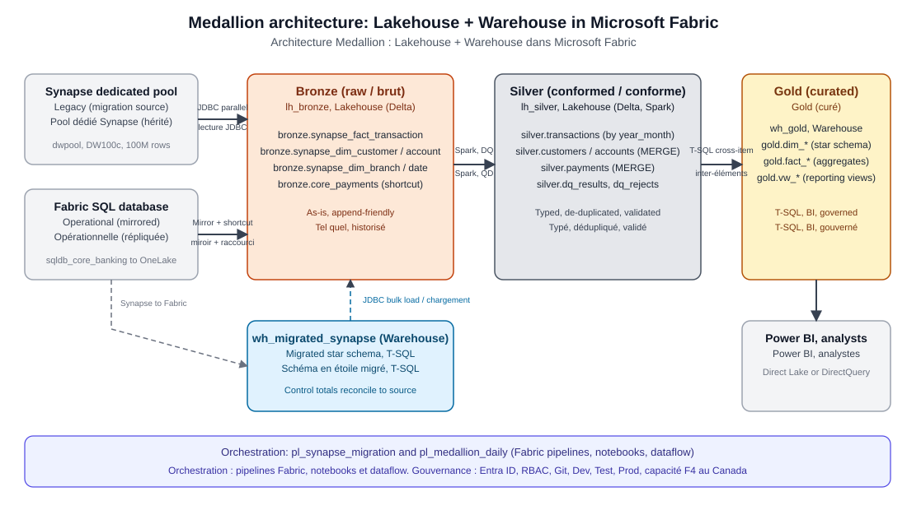

# Microsoft Fabric for Data Engineers: workshop kit

A complete, redeployable workshop for data engineers. It covers Fabric pipelines and dataflows, Lakehouse,
Spark, and Delta, Warehouse and T-SQL, Synapse equivalents and a Synapse dedicated SQL pool migration, OneLake
shortcuts and mirroring, Medallion architecture with a Lakehouse and a Warehouse, notebooks, and Git and
deployment pipelines.

The data is **synthetic** and models a Canadian financial institution. It contains no real customer data.

- Audience: data engineers and regulated-industry teams (for example, OSFI-regulated institutions).
- Length: a 2-hour session. About 30 minutes of slides, 75 minutes of live demo, and a buffer for questions.
- Guide for presenters: [docs/prescriptive-delivery-guide.md](docs/prescriptive-delivery-guide.md)

## What gets deployed

| Layer | Item | Purpose |
|---|---|---|
| Azure (sandbox) | Resource group `rg-fabric-de-workshop`, Synapse workspace, dedicated SQL pool `dwpool` (DW100c) | Legacy source for the migration |
| Fabric capacity | F4 capacity in Canada Central | Compute for all Fabric items (data residency in Canada) |
| Fabric (Dev) | `lh_bronze`, `lh_silver` | Lakehouses (Delta, Spark, schemas) |
| Fabric (Dev) | `wh_migrated_synapse` | Warehouse that receives the migrated Synapse star schema |
| Fabric (Dev) | `wh_gold` | Warehouse for the gold star schema and reporting views |
| Fabric (Dev) | `sqldb_core_banking` | Fabric SQL database, mirrored to OneLake (mirroring source) |
| Fabric (Dev) | `nb_00` to `nb_05` | Notebooks: connectivity check, migration, Bronze to Silver, Delta deep dive, Gold, rebuild maintenance |
| Fabric (Dev) | `pl_synapse_migration`, `pl_medallion_daily` | Data pipelines |
| Fabric (Dev) | `df_province_reference` | Dataflow Gen2 (reference data) |
| Fabric (Dev) | Shortcuts | `lh_bronze` to the SQL database mirror; `lh_silver` to `lh_bronze` (no copies) |
| Fabric | Workspaces `FDW-Dev/Test/Prod-OSFI-2610`, deployment pipeline `dp_fdw_osfi` | Dev, Test, and Prod with Git integration on Dev |
| GitHub | This repository, Dev items under `fabric-workspace/` | Git integration |

## Architecture



Full diagram, data flow, and Mermaid version: [docs/architecture/medallion-architecture.md](docs/architecture/medallion-architecture.md).

## Prerequisites

- PowerShell 7.4 or later (`pwsh`).
- Azure CLI, signed in with `az login`, to a tenant with an Azure subscription where you can create resources and
  Fabric capacities.
- Access to Microsoft Fabric. You need an F-SKU capacity, or a region-matched trial capacity for small tests.
- Permission to create a Synapse workspace, a dedicated SQL pool, and a storage account in the subscription.
- Module `SqlServer` (for `Invoke-Sqlcmd`), with `Install-Module SqlServer -Scope CurrentUser`.
- Git and, for the Git section, a GitHub personal access token with `repo` scope in the `GITHUB_PAT` environment
  variable (or `gh auth login`).

## Quick start

1. Edit [config/workshop.settings.json](config/workshop.settings.json). Set `subscriptionId`, `tenantId`,
   `fabric.capacityAdmin` (a UPN in your tenant), `fabric.capacityResourceGroup`, `storage.accountName`,
   `synapse.workspaceName`, and `git.owner` and `git.repo`. Names must be globally unique.
2. Deploy everything in dependency order (about 60 minutes, mostly data loads):

   ```powershell
   pwsh ./scripts/deploy-all.ps1
   ```

   Useful switches: `-SkipAzure`, `-SkipPrestage`, `-SkipMigrationRun`, `-DeployToProd`.
3. Before a session, resume billable resources: `pwsh ./scripts/pause-resume.ps1 -Action Resume`.
4. After a session, pause them: `pwsh ./scripts/pause-resume.ps1 -Action Pause`.
5. Reset demo state between sessions: `pwsh ./scripts/reset-demo.ps1`.
6. Tear down: `pwsh ./scripts/teardown.ps1 -DeleteFabricWorkspaces -DeleteAzureResources`.

## Repository layout

```
config/                    Non-secret settings (subscription, names, sizes)
scripts/                   PowerShell deployment and operations (run in numbered order)
  common.ps1               Shared helpers: Entra tokens, Fabric REST with long-running operations, SQL access
  01-deploy-azure.ps1      Resource group, F4 capacity, Synapse workspace, DW100c pool, firewall
  02-deploy-fabric.ps1     Workspaces (Dev, Test, Prod) and Dev items
  03-prestage-synapse-source.ps1   Legacy source schema and 100M synthetic rows in Synapse
  04-seed-fabric-sqldb.ps1         Mirroring source data in the Fabric SQL database
  05-deploy-warehouse-ddl.ps1      Migrated and gold warehouse DDL
  06-deploy-notebooks.ps1          Notebooks from notebooks/ in Fabric git format
  07-create-shortcuts.ps1          OneLake shortcuts
  08-deploy-pipelines.ps1          Pipelines and dataflows
  09-create-gold-views.ps1         Reporting views in wh_gold
  10-git-and-deployment.ps1        GitHub connection, Git integration, deployment pipeline
  deploy-all.ps1, pause-resume.ps1, reset-demo.ps1, teardown.ps1
sql/synapse/               Legacy Synapse DDL (DISTRIBUTION, columnstore) and synthetic data generator
sql/fabric-sqldb/          Fabric SQL database seed (core banking, mirrored)
sql/fabric-warehouse/      Converted warehouse DDL, gold schema, gold procedure, reporting views
notebooks/                 Fabric notebooks (.py, fabricGitSource format)
pipelines/                 Pipeline definitions (JSON)
dataflows/                 Dataflow Gen2 definitions (mashup.pq, queryMetadata.json)
fabric-workspace/          Items exported by Fabric Git integration (Dev workspace)
docs/                      Guide, best practices, Synapse equivalents, migration runbook, architecture, slide deck (docs/presentation)
diagrams/                  Architecture diagram (SVG, bilingual labels)
```

## Security and data handling

- Authentication uses Microsoft Entra ID tokens from `az login`. No passwords or keys are stored in the repository.
  The Synapse SQL admin password is generated in memory and discarded.
- `.workshop-state/state.json` holds resource IDs only. It is git-ignored. Note that the Git connection in Fabric
  stores your GitHub token (encrypted, inside Fabric). Revoke that token when the workshop ends.
- The Synapse workspace allows Azure services (`0.0.0.0`) so Fabric Spark can reach the pool. Production should use
  private endpoints and managed virtual networks instead. See the guide's best practices.
- All data is synthetic. Do not load real customer data into this kit.

## Sandbox notes (MCAPS governance)

Some of these behaviours came from tenant policies and are documented so you can plan around them:

- Storage accounts and Azure SQL servers may be created with public network access disabled. The workshop therefore
  uses Fabric-native sources (a Fabric SQL database) and OneLake shortcuts, not ADLS or Azure SQL. The guide
  explains the production pattern.
- Azure SQL servers must enable Entra-only authentication at creation time.
- Fabric capacity administrators must be UPNs in the capacity's tenant. Object IDs are rejected.
