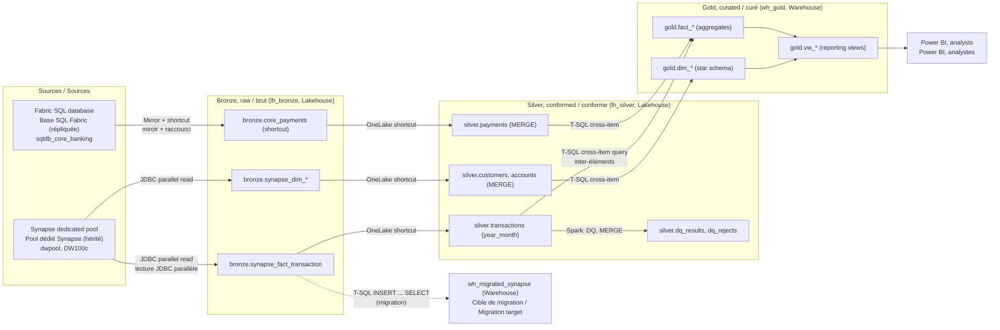

# Medallion architecture: Lakehouse + Warehouse in Microsoft Fabric

Architecture Medallion : Lakehouse + Warehouse dans Microsoft Fabric

This is the reference pattern the workshop deploys. The SVG version is [diagrams/medallion-architecture.svg](../../diagrams/medallion-architecture.svg).

## Diagram (Mermaid)

## Layer responsibilities

| Layer | Item | Engine | What lives here | Why |
|---|---|---|---|---|
| Bronze / brut | `lh_bronze` (Lakehouse) | Spark, Delta | Source data as received. Append-friendly. No business rules. | Keep raw history for replay and audit. Delta gives ACID writes and time travel. |
| Silver / conforme | `lh_silver` (Lakehouse) | Spark, Delta | Typed, de-duplicated, validated, and conformed entities. Data-quality logs. | Data engineers work in Spark and Python. MERGE keeps dimensions current. |
| Gold / curé | `wh_gold` (Warehouse) | T-SQL | Star schema, aggregates, and reporting views. | Analysts and BI tools use T-SQL. Warehouse gives strong SQL semantics and governance. |
| Migration target | `wh_migrated_synapse` (Warehouse) | T-SQL | The legacy Synapse star schema, converted to Fabric DDL. | Lets you reconcile the migration against the source with control totals. |

## Data flow for the Medallion pipeline

1. `Refresh province reference` (Dataflow Gen2) builds a small reference table in Power Query.
2. `Bronze to Silver` (`nb_02_bronze_to_silver`) reads bronze through OneLake shortcuts. It applies typing,
   de-duplication, and data-quality rules. Dimensions use MERGE. Transactions are written by `year_month`.
   Rejected rows go to `silver.dq_rejects` as JSON. Each run is logged to `silver.dq_results`.
3. `Silver to Gold` (`nb_04_silver_to_gold_warehouse`) refreshes the lakehouse SQL endpoint metadata, then runs
   `gold.usp_load_gold` in `wh_gold`. The procedure truncates and reloads the star schema from silver.

## Design decisions to explain to the audience

- **Shortcuts instead of copies.** `lh_silver` reads `lh_bronze` through OneLake shortcuts, and `lh_bronze` reads the
  Fabric SQL database mirror through a shortcut. No data is duplicated between layers.
- **Engine by persona.** Spark and Python for data engineering (silver). T-SQL for analysts and BI (gold).
- **Control totals.** The migrated warehouse reconciles to Synapse on row count (100,000,000), the large cash-flag
  count (2,000,000), and total amount (284,999,500,000.00).
- **Lakehouse SQL endpoints are asynchronous.** A newly written Delta table can take minutes to appear to the
  warehouse. The notebooks call `refreshMetadata` before cross-item queries, and retry where needed.
- **Residency.** Every item runs on a capacity in Canada Central, so data stays in Canada.

## Observed behaviour (tested in this workshop)

- Fabric notebooks do not expose a SQL audience key to `notebookutils.credentials.getToken`, but the raw resource URL
  `https://database.windows.net/` works. `DefaultAzureCredential` does not work in Fabric notebooks.
- The Microsoft JDBC driver inside a notebook can run T-SQL on a warehouse with the same token. This is used for
  warehouse loads and procedure calls.
- Notebooks with a markdown cell at the top of the file lost their default-lakehouse binding on upload. Start notebooks
  with a code cell.
